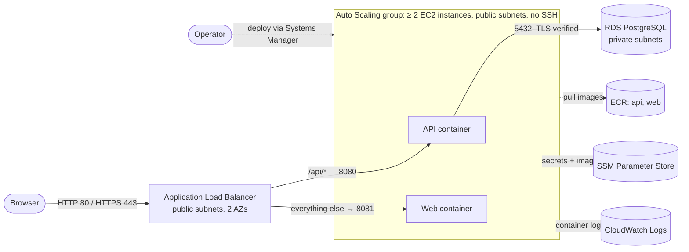

# AWS infrastructure (Bash + AWS CLI v2)

Scripts that create, release, inspect and remove the AWS environment for Track Management
(the .NET API in this repository and the React web app in the frontend repository).
`dev`, `staging` and `prod` are separate environments, each driven by one file in `config/`.

> **Not yet run against AWS.** The scripts pass `validate.sh` (syntax, ShellCheck, configuration,
> rendered user data, safety guards with a fake AWS CLI), but they have not created real resources.
> Run them first in a test account, with `dev`.

## Architecture



| Piece | Choice | Why |
|---|---|---|
| Compute | EC2 Auto Scaling group (≥ 2 instances, two AZs), Docker on Amazon Linux 2023 | Same containers as `docker compose`; the group replaces failed instances |
| Entry | Application Load Balancer; `/api/*` → API target group (health `/health`), rest → web | One origin for the app (no CORS); health checks include the database |
| Database | RDS PostgreSQL 17, `db.t4g.micro`, private subnets, encrypted, TLS verified (`VerifyFull`) | Managed backups and patching; never reachable from the internet |
| Images | ECR, one repository per image, immutable tags, scan on push | Rollback = deploy an older tag |
| Secrets | SSM Parameter Store SecureString, generated by `setup.sh` | Never in files, user data or command lines |
| Access | Systems Manager (Run Command / Session Manager); no SSH key, no port 22 | Nothing to leak, every command audited |
| Network | No NAT gateway: instances have public IPs but accept traffic only from the load balancer's security group | Saves the NAT gateway's hourly cost |
| Not used | ElastiCache, ECS, NAT, S3 (optional, off) | The app has no cache or file storage |

## Prerequisites

- AWS CLI v2, bash 4.4+ (macOS: `brew install bash`), Docker, git, openssl, curl.
  Linux, macOS, WSL or AWS CloudShell; Git Bash on Windows works too.
- Signed in with **your own** credentials: `aws configure sso` + `aws sso login`, or an assumed role.
  Nothing in this folder stores credentials. Avoid the account root user.
- The backend and frontend clones side by side (`frontend/` or `takwene-track-frontend/`), or `--frontend-dir`.

## Running on Windows

- Use **Git Bash**, the shell that comes with Git for Windows (bash 5). PowerShell and `cmd` cannot run these scripts.
- Run every command from `backend/infra/aws`:
  ```bash
  cd /c/path/to/takwene-track-backend/infra/aws
  ```
- The scripts keep **LF** line endings on every machine (`.gitattributes` sets `*.sh text eol=lf`). Don't
  convert them to CRLF: bash then fails with errors such as `$'\r': command not found`.
- Configure the AWS CLI first with `aws sso login` (after `aws configure sso`) or `aws configure`. The
  scripts use whatever sign-in the CLI has; they never ask for or store keys.
- `bash setup.sh --env dev` works even if the executable bit is missing (the same for every script),
  so you never need `chmod`.
- Docker Desktop must be running for `deploy.sh` (it builds the images).

## Commands

```bash
cd infra/aws
./validate.sh --shellcheck-docker   # local checks only, no AWS calls
./preflight.sh --env dev            # read-only AWS checks (sign-in, zones, instance and DB types)
./setup.sh --env dev                # creates/updates everything (asks you to type "dev")
./deploy.sh --env dev               # builds both images, pushes them, rolls them out
./status.sh --env dev               # read-only overview, including target health
./destroy.sh --env dev              # deletes the environment (asks you to type "trackmgmt-dev")
```

After the first deploy, sign in at the URL `deploy.sh` prints with `ADMIN_EMAIL` and the generated password:

```bash
aws ssm get-parameter --region eu-central-1 --name /trackmgmt/dev/admin-password \
  --with-decryption --query Parameter.Value --output text
```

More options:

| Command | What it does |
|---|---|
| `./setup.sh --env dev --only alb,compute` | Re-run selected steps: `network security-groups ecr secrets logs s3 rds iam alb compute` |
| `./deploy.sh --env prod --image-tag <tag>` | Release (or roll back to) images already in ECR, without building |
| `./deploy.sh --env dev --refresh-instances` | Replace instances after a launch-template change (rolling, 50% stay in service) |
| `./destroy.sh --env dev --skip-final-snapshot` | No final database snapshot |
| `./destroy.sh --env dev --purge-data` | Also delete ECR images, SSM secrets, the log group and an empty bucket |
| `./destroy.sh --env prod --allow-prod` | prod needs this flag, and deletion protection must be switched off by hand first |
| Any script with `--yes` / `--confirm <prefix>` | Skip the prompt (CI) |

## Environments

**`dev` is the environment intended for testing.** `staging` and `prod` are examples of how the same
scripts scale up (bigger instances, longer backups, deletion protection); review them before using them.

| Setting | dev | staging | prod |
|---|---|---|---|
| VPC | 10.10.0.0/16 | 10.20.0.0/16 | 10.30.0.0/16 |
| Instances | 2 × t3.micro | 2–3 × t3.small | 2–4 × t3.small |
| Database backups | 1 day | 3 days | 7 days |
| Deletion protection (DB, ALB) | off | off | on |
| Log retention | 7 days | 14 days | 30 days |

Change settings in `config/<env>.env`; personal or account-specific values go in
`config/<env>.local.env` (git-ignored). Every value is validated before any AWS call.
HTTPS: set `CERTIFICATE_ARN` to an issued ACM certificate in the same region; port 80 then redirects.

## How a release works

1. `deploy.sh` builds `linux/amd64` images tagged `<UTC time>-api<sha>-web<sha>` (refuses uncommitted
   changes unless `--allow-dirty`) and pushes them to ECR.
2. The tag is stored in `/trackmgmt/<env>/image-tag`.
3. Through Systems Manager, the first instance restarts with `Database__MigrateOnStartup=true`
   (migrations, admin account, sample data on an empty database); the others restart one by one
   without it. Each waits for `/health` before the next starts.
4. The Auto Scaling group switches to load-balancer health checks. New instances (scaling, refresh)
   start the stored tag on boot without migrations.

## Cost

Billed while they exist: the load balancer (hourly + capacity units), the EC2 instances and their
volumes, public IPv4 addresses, the RDS instance and its storage, CloudWatch Logs, ECR storage and
any final database snapshot. Expect tens of US dollars per month per environment at these sizes;
check the AWS Pricing Calculator for your region before running `setup.sh`. `destroy.sh` removes
everything billable except, by default, the final snapshot, ECR images and logs (`--purge-data`).

## Known limits

- **Untested against AWS** (see the top). Real runs may surface timing or permission details.
- **Sample data in every environment:** the API adds the labelled sample catalogue to an *empty*
  database on its first start with migrations. There is no switch for it in the application today.
- **Migrations during a rolling release** run while older instances still serve: keep schema
  changes backward compatible (expand, then contract).
- HTTP only until a certificate is configured (no domain yet).
- Single-AZ database by default (project decision); `DB_MULTI_AZ=true` adds a standby.
- Narrowing `ALB_INGRESS_CIDR` adds the new rule but does not remove the old one; removing
  `CERTIFICATE_ARN` later leaves the 443 listener in place. Remove those by hand.
- Rate limits are per API instance (in memory), so the effective limit grows with the instance count.
